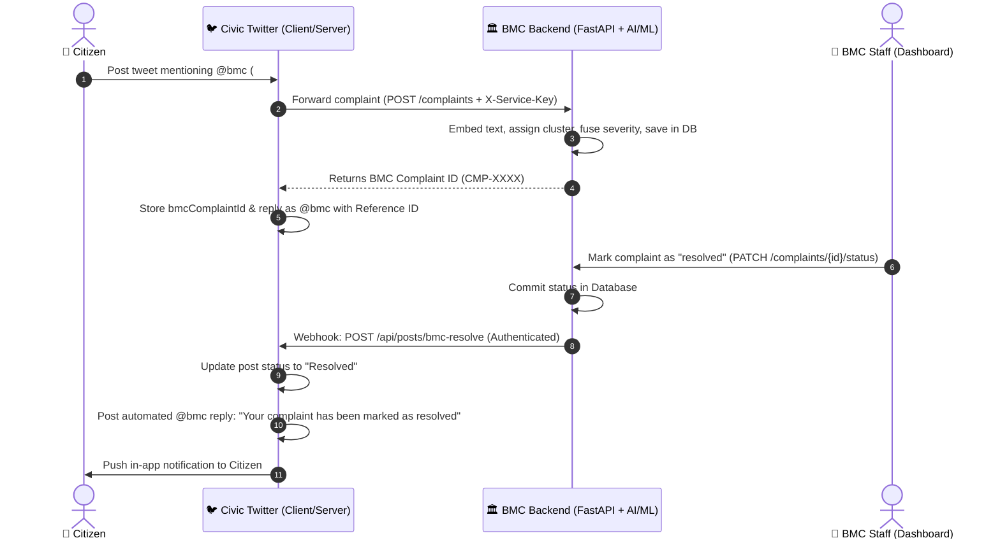

# BMC Civic Complaint Clustering & Twitter Social Media Platform 🏛️🐦

A complete, full-stack civic tech ecosystem integrating an **AI/ML-powered BMC Civic Complaint Clustering Portal** with a **Civic Twitter Social Media Platform**, featuring bidirectional complaint registration, real-time status tracking, and automated resolution synchronization.

---

## 🌟 Overview

Citizens often report civic issues (potholes, garbage dumps, drainage overflows, waterlogging) on social media platforms like Twitter. This project bridges public social reporting directly with official municipal administration workflows:

1. **Social Reporting**: Citizens post civic complaints on Twitter Clone mentioning `@bmc`.
2. **Automated BMC Ingestion & AI Clustering**: The post is forwarded to the BMC backend where it is analyzed with NLP embeddings (`paraphrase-multilingual-MiniLM-L12-v2`), clustered by geospatial and semantic similarity, and prioritized with multimodal severity classification.
3. **Immediate Citizen Feedback**: An official `@bmc` bot automatically replies to the citizen's tweet with their official BMC Complaint Reference ID.
4. **Municipal Resolution Workflow**: BMC staff review and update complaints through the dedicated BMC Staff Dashboard.
5. **Live Resolution Synchronization**: When BMC staff marks a complaint as **Resolved**, the BMC backend notifies the Twitter Clone backend via an authenticated webhook, updates the tweet status, notifies the citizen, and posts an official resolution reply from `@bmc`.

---

## 🏛️ Ecosystem Architecture & Data Flow



---

## 📁 Repository Structure

```
.
├── Mini Proj/                      # BMC Civic Complaint Clustering System
│   ├── backend/                    # FastAPI backend with ML pipeline & resolution sync
│   │   ├── app/
│   │   │   ├── main.py             # API routes & lifespan setup
│   │   │   ├── twitter_sync.py     # Authenticated retry webhook to Twitter
│   │   │   ├── services.py         # Centroid clustering, reranking, ML inference
│   │   │   ├── models.py           # SQLAlchemy database schemas
│   │   │   ├── auth.py             # JWT authentication & password hashing
│   │   │   ├── db.py               # Database engine (PostgreSQL / SQLite fallback)
│   │   │   └── provision_bmc_staff.py # Staff account provisioning
│   │   └── tests/                  # Backend unit & integration test suites
│   ├── frontend/                   # BMC Staff Dashboard (React + Leaflet + Vite)
│   ├── citizen-frontend/           # Public Citizen Complaint Portal (React + Vite)
│   ├── artifacts/                  # Trained NLP & Computer Vision model weights
│   ├── docker-compose.yml          # Container configuration
│   └── .env.example                # Sample environment variables
│
├── clone twitter/                  # Civic Twitter Platform
│   ├── client/                     # Twitter UI (React 19, Tailwind CSS, Vite)
│   │   └── src/
│   │       ├── components/         # TweetBox, PostCard, Badges, Modals
│   │       └── pages/              # Feed, PostDetail, Profile, Notifications
│   ├── server/                     # Twitter Backend (Node.js, Express, MongoDB)
│   │   └── src/
│   │       ├── controllers/        # Post, comment, auth, and webhook controllers
│   │       ├── middleware/         # JWT auth & serviceAuth (X-Service-Key)
│   │       ├── models/             # Mongoose schemas (Post, Comment, User, Notification)
│   │       ├── services/bmcService.js # BMC forwarding & resolution reply handler
│   │       └── server.js           # Server entry point
│   └── .env.example
│
├── test_e2e_resolution_sync.js     # End-to-end automated multi-service test suite
├── run_all.ps1                     # One-click Windows PowerShell service launcher
└── README.md
```

---

## 💻 System Requirements & Prerequisites

Ensure the following tools are installed on your system before running:

| Requirement | Minimum Version | Recommended | Notes |
| :--- | :--- | :--- | :--- |
| **Node.js** | v18.0.0+ | v20+ / v22+ | Required for frontend builds & Express server |
| **npm** | v9.0.0+ | v10+ / v11+ | Included with Node.js |
| **Python** | 3.10+ | 3.11 / 3.12 / 3.14 | Required for FastAPI, PyTorch & scikit-learn |
| **MongoDB** | 6.0+ | Local or Atlas | Database for Civic Twitter |
| **Operating System** | Windows, macOS, or Linux | Windows 10/11 or Ubuntu | Cross-platform |

---

## ⚙️ Step-by-Step Setup & Installation

### 1. Clone the Repository
```bash
git clone https://github.com/anuj8104340394-cyber/mini-proj-.git
cd mini-proj-
```

---

### 2. Configure Environment Files (`.env`)

#### A. BMC Complaint Portal Environment
Create `Mini Proj/.env` by copying `Mini Proj/.env.example`:
```powershell
Copy-Item "Mini Proj\.env.example" "Mini Proj\.env"
```

Default configuration inside `Mini Proj/.env`:
```env
DATABASE_URL=sqlite:///./bmc.db
ARTIFACTS_DIR=./artifacts
CLUSTER_SIMILARITY_THRESHOLD=0.75
MAX_CLUSTER_RADIUS_KM=3.0
SEED_ON_STARTUP=true
SYNC_LIVE_DEMO=true
BMC_SERVICE_KEY=bmc_shared_service_key_2026
TWITTER_API_URL=http://localhost:5000
CITIZEN_FRONTEND_URL=http://localhost:5174
BMC_FRONTEND_URL=http://localhost:5173
JWT_SECRET_KEY=iT9oEsYdeXmfkVZqD75h0ok7gcsFdYyk-6CuMWQxk2k1wcnnUHJVLX0D-3dwU-1YZDFxxftMkpAQlg9M6khMaw
JWT_ACCESS_TOKEN_EXPIRE_MINUTES=60
```
*(If PostgreSQL is not running, the application automatically uses local SQLite `bmc.db` without any extra setup).*

#### B. Twitter Clone Environment
Create `clone twitter/server/.env` by copying `clone twitter/server/.env.example`:
```powershell
Copy-Item "clone twitter\server\.env.example" "clone twitter\server\.env"
```

Default configuration inside `clone twitter/server/.env`:
```env
PORT=5000
MONGO_URI=mongodb://127.0.0.1:27017/twitter_app
JWT_SECRET=supersecretjwtkey_twitter_replica_2026
CLIENT_URL=http://localhost:5175
BMC_API_URL=http://localhost:8000
BMC_SERVICE_KEY=bmc_shared_service_key_2026
```
*(If using MongoDB Atlas cloud cluster, replace `MONGO_URI` with your connection string).*

---

### 3. Install All Dependencies

#### Python Backend Dependencies:
```powershell
cd "Mini Proj\backend"
pip install -r requirements.txt
cd ..\..
```

#### Node.js Dependencies (All Frontend & Server Modules):
```powershell
# 1. BMC Staff Dashboard
cd "Mini Proj\frontend"
npm install

# 2. BMC Citizen Portal
cd "..\citizen-frontend"
npm install

# 3. Twitter Express Backend
cd "..\..\clone twitter\server"
npm install

# 4. Twitter React Client
cd "..\client"
npm install

cd ..\..
```

---

## 🚀 Running the Services

### Option A: One-Click Launcher (Windows PowerShell)

You can launch all 5 services simultaneously in separate windows with one command:

```powershell
powershell -ExecutionPolicy Bypass -File .\run_all.ps1
```

---

### Option B: Running Manually (Separate Terminals)

If you prefer running services in separate terminals:

| Terminal | Service | Command | URL |
| :--- | :--- | :--- | :--- |
| **Terminal 1** | **BMC FastAPI Backend** | `cd "Mini Proj\backend"`<br>`python -m uvicorn app.main:app --host 0.0.0.0 --port 8000` | [http://localhost:8000/docs](http://localhost:8000/docs) |
| **Terminal 2** | **Civic Twitter Server** | `cd "clone twitter\server"`<br>`node src/server.js` | [http://localhost:5000/api/health](http://localhost:5000/api/health) |
| **Terminal 3** | **BMC Staff Dashboard** | `cd "Mini Proj\frontend"`<br>`npm run dev` | [http://localhost:5173](http://localhost:5173) |
| **Terminal 4** | **BMC Citizen Portal** | `cd "Mini Proj\citizen-frontend"`<br>`npm run dev` | [http://localhost:5174](http://localhost:5174) |
| **Terminal 5** | **Civic Twitter Client** | `cd "clone twitter\client"`<br>`npm run dev` | [http://localhost:5175](http://localhost:5175) |

---

## 🔑 Default Credentials

### BMC Staff Portal (`http://localhost:5173`)
| Field | Value |
| :--- | :--- |
| **Email** | `bmc.staff1@local.bmc` *(or `bmc.staff2@local.bmc` through `bmc.staff5@local.bmc`)* |
| **Password** | `Admin@123` |
| **Role** | `admin` |

*(To rotate a staff password: `python -m app.provision_bmc_staff --rotate bmc.staff1@local.bmc`)*

### Civic Twitter Platform (`http://localhost:5175`)
*All demo accounts use password:* **`password123`**
- **Regular Citizen Accounts:** `sarahc`, `marcusj`, `emilyd`, `rohanm`
- **Admin Account:** `alexrivera`
- **Official Bot Account:** `@bmc` *(auto-replies to complaints & resolutions)*

---

## 📱 Progressive Web App (PWA) — Mobile & Desktop Installation

Civic Twitter is built as a production-grade **Progressive Web App (PWA)** that can be installed directly onto your device without needing Google Play Store or Apple App Store:

### 📲 Features:
- **Standalone App Experience:** Launches in its own dedicated, borderless window without browser URL bars.
- **Home Screen & Desktop Icon:** Crisp, high-resolution app icon on your home screen and taskbar.
- **Offline Shell & Caching:** Offline fallback screen (`offline.html`) and automatic asset caching with service worker (`sw.js`).
- **In-App Install Prompt:** Click the **"Install App"** button in the sidebar, header, or floating banner.
- **Auto Update Detection:** Informs users when a new frontend update is available with a 1-click update banner.

### 🚀 How to Install:
- **Android (Chrome / Samsung Internet / Edge):**
  1. Open `http://localhost:5175` (or your public URL/LAN IP) in Chrome.
  2. Tap the **"Install App"** button on screen, or tap `⋮` (menu) $\rightarrow$ **"Install app"** / **"Add to Home screen"**.
- **iPhone / iPad (iOS Safari):**
  1. Open the website in Safari.
  2. Tap the **Share** button in Safari's bottom toolbar.
  3. Scroll down and tap **"Add to Home Screen"** $\rightarrow$ tap **"Add"**.
- **Windows / macOS / Linux (Chrome & Edge):**
  1. Open the website in Chrome or Microsoft Edge.
  2. Click the **"Install App"** icon in the desktop navigation or the install icon in the browser address bar.

---

## 🧪 Testing the Resolution Synchronization

To verify that the complete complaint registration and resolution synchronization workflow is working:

```powershell
node test_e2e_resolution_sync.js
```

### What this test verifies:
1. **Security**: Verifies that unauthenticated or tampered requests to `/api/posts/bmc-resolve` are rejected with `401 Unauthorized` / `403 Forbidden`.
2. **Registration**: Posts a civic complaint on Twitter mentioning `@bmc` $\rightarrow$ verifies it is ingested into BMC database with cluster & severity assigned.
3. **Bot Reply**: Verifies the official `@bmc` bot publishes an automated reference reply under the citizen's tweet.
4. **Staff Resolution**: Staff marks complaint as `resolved` on BMC Staff Portal $\rightarrow$ database commit verified.
5. **Auto-Reply**: Verifies exactly **one** resolution reply from `@bmc` is published:
   > *"Your complaint #CMP-XXXX has been marked as resolved by BMC. Please check the BMC Complaint Portal for updates."*
6. **In-App Notification**: Verifies citizen receives resolution notification on Twitter.
7. **Idempotency**: Retries and duplicate calls are safely skipped without creating duplicate replies.
8. **Reopen & Re-resolve**: Verifies complaints reopened by staff update the tweet to `open`, and re-resolving publishes a new resolution reply for that cycle.

---

## 🛠️ Troubleshooting & FAQs

### 1. `Port already in use`
- Ensure no other service is occupying ports `8000`, `5000`, `5173`, `5174`, or `5175`.
- On Windows, check with:
  ```powershell
  Get-NetTCPConnection -LocalPort 8000, 5000, 5173, 5174, 5175
  ```

### 2. MongoDB DNS Resolution on Windows
- If connecting to MongoDB Atlas on Windows fails with `querySrv ECONNREFUSED`, Google Public DNS servers are automatically configured in `server.js`:
  ```javascript
  const dns = require('dns');
  dns.setServers(['8.8.8.8', '1.1.1.1']);
  ```

### 3. PostgreSQL vs SQLite Fallback
- The BMC backend is pre-configured to automatically fall back to local SQLite (`bmc.db`) if a PostgreSQL server is not detected, enabling instant local development without Docker.

---

## 📄 License

This project is licensed under the MIT License.
