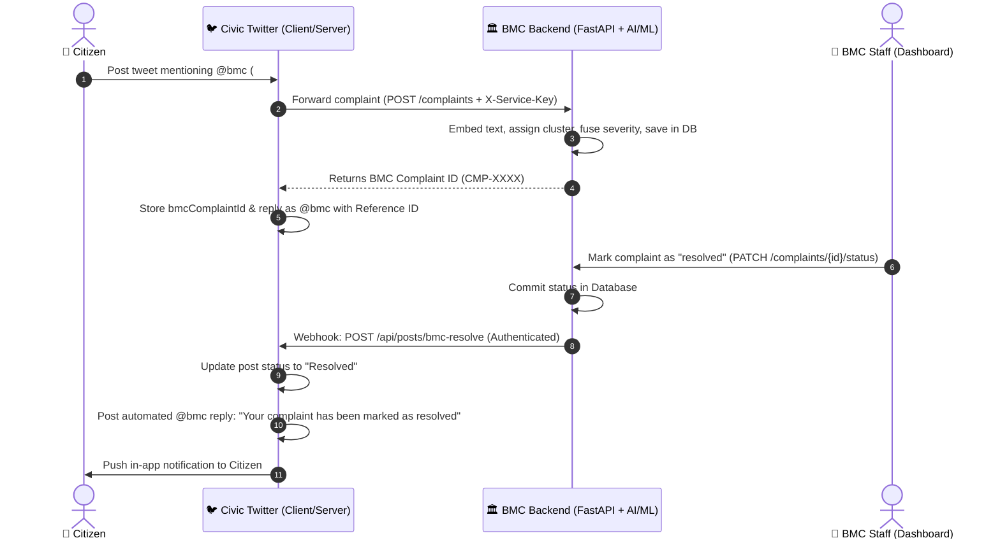

# BMC Civic Complaint Clustering & Twitter Social Media Platform 🏛️🐦

A complete, full-stack civic tech ecosystem integrating an **AI/ML-powered BMC Civic Complaint Clustering Portal** with a **Civic Twitter Social Media Platform**, featuring bidirectional complaint registration, real-time status tracking, and automated resolution synchronization.

---

## 🌟 Overview

Citizens often report civic issues (potholes, garbage dumps, drainage overflows, waterlogging) on social media platforms like Twitter. This project bridges public social reporting directly with official municipal administration workflows:

1. **Social Reporting**: Citizens post civic complaints on Twitter Clone mentioning `@bmc`.
2. **Automated BMC Ingestion & AI Clustering**: The post is forwarded to the BMC backend where it is analyzed with NLP embeddings (`paraphrase-multilingual-MiniLM-L12-v2`), clustered by geospatial and semantic similarity, and prioritized with multimodal severity classification.
3. **Immediate Citizen Feedback**: An official `@bmc` bot automatically replies to the citizen's tweet with their official BMC Complaint Reference ID.
4. **Municipal Resolution Workflow**: BMC staff review and update complaints through the dedicated BMC Staff Dashboard.
5. **Live Resolution Synchronization**: When BMC staff marks a complaint as **Resolved**, the BMC backend notifies the Twitter Clone backend via an authenticated webhook, updates the tweet status, notifies the citizen, and posts an official resolution reply from `@bmc`.

---

## 🏛️ Ecosystem Architecture & Data Flow



---

## 📁 Repository Structure

```
.
├── Mini Proj/                      # BMC Civic Complaint Clustering System
│   ├── backend/                    # FastAPI backend with ML pipeline & resolution sync
│   │   ├── app/
│   │   │   ├── main.py             # API routes & lifespan setup
│   │   │   ├── twitter_sync.py     # Authenticated retry webhook to Twitter
│   │   │   ├── services.py         # Centroid clustering, reranking, ML inference
│   │   │   ├── models.py           # SQLAlchemy database schemas
│   │   │   ├── auth.py             # JWT authentication & password hashing
│   │   │   ├── db.py               # Database engine (PostgreSQL / SQLite fallback)
│   │   │   └── provision_bmc_staff.py # Staff account provisioning
│   │   └── tests/                  # Backend unit & integration test suites
│   ├── frontend/                   # BMC Staff Dashboard (React + Leaflet + Vite)
│   ├── citizen-frontend/           # Direct Citizen Complaint Portal (React + Vite)
│   ├── artifacts/                  # Trained NLP & Computer Vision model weights
│   ├── docker-compose.yml          # Container configuration
│   └── .env.example                # Sample environment variables
│
├── clone twitter/                  # Civic Twitter Platform
│   ├── client/                     # Twitter UI (React 19, Tailwind CSS, Vite)
│   │   └── src/
│   │       ├── components/         # TweetBox, PostCard, Badges, Modals
│   │       └── pages/              # Feed, PostDetail, Profile, Notifications
│   ├── server/                     # Twitter Backend (Node.js, Express, MongoDB)
│   │   └── src/
│   │       ├── controllers/        # Post, comment, auth, and webhook controllers
│   │       ├── middleware/         # JWT auth & serviceAuth (X-Service-Key)
│   │       ├── models/             # Mongoose schemas (Post, Comment, User, Notification)
│   │       ├── services/bmcService.js # BMC forwarding & resolution reply handler
│   │       └── server.js           # Server entry point
│   └── .env.example
│
├── test_e2e_resolution_sync.js     # End-to-end automated multi-service test suite
└── README.md
```

---

## 🚀 Getting Started

### Prerequisites

- **Node.js** (v18+)
- **Python** (3.10+)
- **MongoDB** (running locally on `mongodb://127.0.0.1:27017` or cloud MongoDB Atlas)

---

### 1. Start the BMC Complaint Backend & Portals

#### Backend API (Port 8000)
```powershell
cd "Mini Proj\backend"
pip install -r requirements.txt
python -m uvicorn app.main:app --host 0.0.0.0 --port 8000
```
*API interactive documentation will be live at `http://localhost:8000/docs`.*

#### BMC Staff Portal (Port 5173)
```powershell
cd "Mini Proj\frontend"
npm install
npm run dev
```
*Accessible at `http://localhost:5173`.*

#### Citizen Portal (Port 5174)
```powershell
cd "Mini Proj\citizen-frontend"
npm install
npm run dev
```
*Accessible at `http://localhost:5174`.*

---

### 2. Start the Civic Twitter Clone

#### Twitter Express Server (Port 5000)
```powershell
cd "clone twitter\server"
npm install
node src/server.js
```
*Server running at `http://localhost:5000`.*

#### Twitter Web Client (Port 5175)
```powershell
cd "clone twitter\client"
npm install
npm run dev
```
*Social app accessible at `http://localhost:5175`.*

---

## 🔑 Default Credentials

### BMC Staff Portal (`http://localhost:5173`)
| Field | Value |
| :--- | :--- |
| **Email** | `bmc.staff1@local.bmc` *(or `bmc.staff2@local.bmc` – `bmc.staff5@local.bmc`)* |
| **Password** | `Admin@123` |
| **Role** | `admin` |

### Civic Twitter Platform (`http://localhost:5175`)
*All demo accounts use password:* **`password123`**
- **User accounts:** `sarahc`, `marcusj`, `emilyd`, `rohanm`
- **Admin account:** `alexrivera`
- **Official Bot Account:** `@bmc`

---

## 🧪 Automated Testing

### Run the Complete End-to-End Test Suite

Tests the entire lifecycle across both applications: Twitter post registration $\rightarrow$ BMC portal ingestion $\rightarrow$ BMC staff resolution $\rightarrow$ automatic `@bmc` reply $\rightarrow$ citizen notification $\rightarrow$ idempotency & deduplication $\rightarrow$ reopening & re-resolving.

```powershell
node test_e2e_resolution_sync.js
```

### Run BMC Backend Unit Tests
```powershell
cd "Mini Proj\backend"
python -m unittest discover -s tests -p "test_*.py"
```

---

## 🔒 Security & Synchronization Features

- **Authenticated Webhooks**: Backend-to-backend communication uses constant-time comparison (`crypto.timingSafeEqual`) against a shared `X-Service-Key`.
- **Database-Commit Gating**: Automated resolution replies trigger strictly **after** the status change has been committed to the database.
- **Deduplication & Idempotency**: Event keys track resolution cycles to safely drop duplicate requests or retries without posting repeated comments.
- **Reopen & Re-resolve Policy**: Complaints reopened by staff transition to `open` on Twitter and notify the citizen; subsequent resolutions trigger a fresh resolution reply for that new cycle.
- **Network Resilience**: Exponential backoff retry logic (1s, 2s, 4s) ensures transient network hiccups do not drop resolution events.

---

## 📄 License

This project is licensed under the MIT License.
